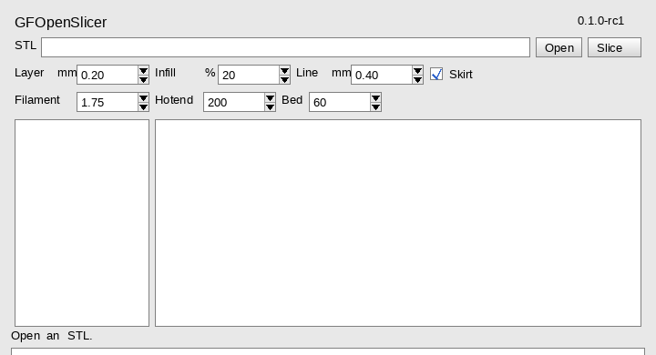
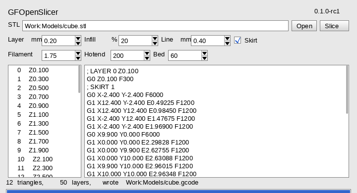

# GFOpenSlicer

GFOpenSlicer 0.1.0-rc1 slices an STL to G-code on AmigaOS 3.2. The window is
GFOpenLayout. The same engine runs from the shell, and the host tests run it
with no Amiga.





Open asks for a file. Slice reads the fields and writes G-code next to the
STL, with `.gcode` in place of `.stl`. The list is one row a layer. Choosing
a row shows that layer.

From the shell:

```
gfopenslicer in.stl out.gcode LAYER=0.2 INFILL=20 LINE=0.4 FILAMENT=1.75 HOTEND=200 BED=60 SKIRT=1
```

## What a slice does

It reads a binary STL or an ASCII one. A binary file is little-endian, which
is how a desktop saves it, so the same file loads on the 68000. Vertices that
land on each other are welded, empty triangles are dropped, and the outside
is turned out.

Each layer is the triangles cut by a plane. The pieces are joined into loops.
The outline is one wall. Infill is even-odd lines at 45 degrees. The first
layer can have a rectangular skirt. Extrusion comes from the layer height,
the line width and the filament diameter. A hotend or a bed of 0 leaves that
temperature command out.

## Not in this release

One wall, not several. The skirt is a rectangle, not the outline. There is no
brim, no support, and no start or end G-code of your own. There is no picture
of the layer: the text is the layer.

## Building

The host check:

```
make test
```

The Amiga program is `src/amiga.c`. It needs `gfopenlayout.library` and the
link library that goes with it:

```
m68k-amigaos-gcc -O2 -std=c99 -noixemul -Iinclude -o GFOpenSlicer \
    src/amiga.c src/job.c src/stl.c src/slice.c -lgfopenlayout -lm
```

The pictures above are the real GFOpenLayout draw list, painted on the host.
`make preview` rebuilds that tool when GFOpenLayout is checked out beside
this tree (`LAYOUT=` if it is not).
